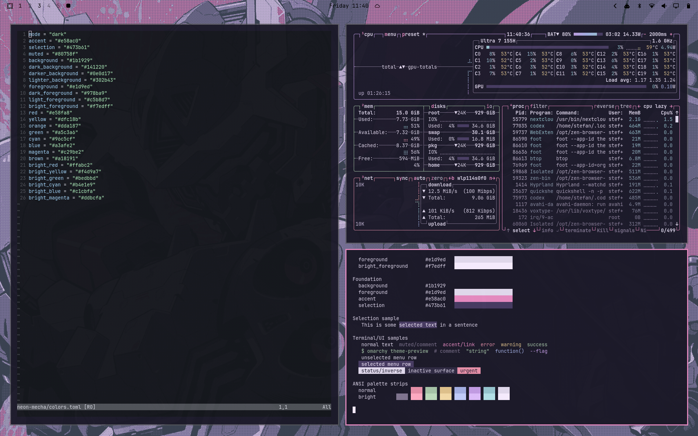
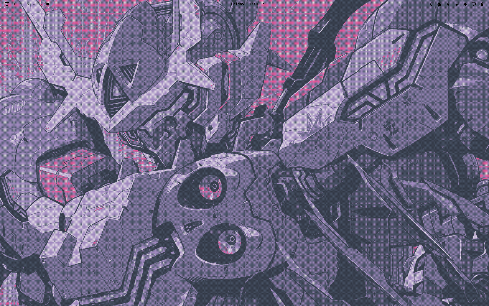

# Neon Mecha

A custom dark Omarchy theme with a matching wallpaper.





## Install

```sh
omarchy theme install https://github.com/T3rr0or/omarchy-neon-mecha-theme
```

## Install locally

Copy this directory to `~/.config/omarchy/themes/neon-mecha`, then run:

```sh
omarchy theme set neon-mecha
```

The palette uses Omarchy's `colors.toml` format. Application configurations are generated by Omarchy.
